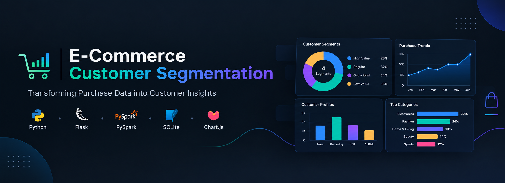
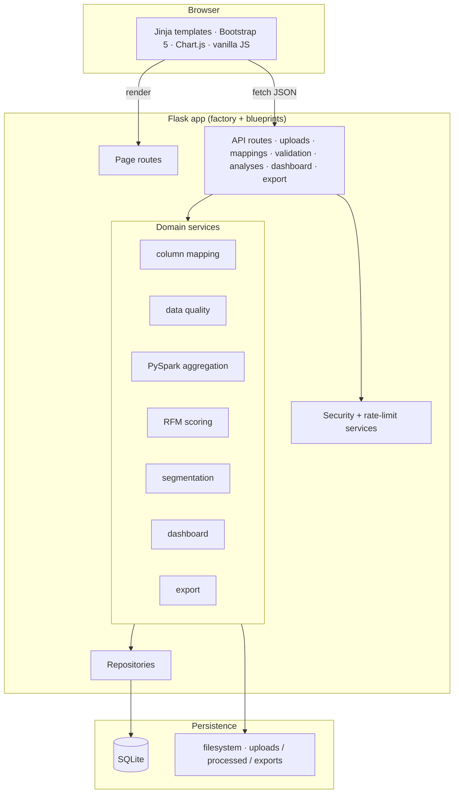
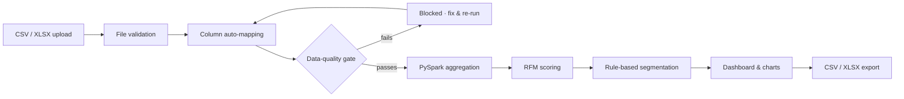

<p align="center">
  
</p>

<h1 align="center">E-Commerce Customer Segmentation Dashboard</h1>

<p align="center">
  A full-stack, data-driven analytics platform that turns raw e-commerce transactions into
  interpretable RFM customer segments — powered by Flask, Apache PySpark and Chart.js.
</p>

<p align="center">
  
  
  
  
  
</p>

---

> **Project status:** Phases 0–11 are implemented and verified by an automated suite
> (**233 passed, 1 pre-existing warning**). The full pipeline — upload → mapping → validation →
> PySpark aggregation → RFM → segmentation → **dashboard** → **CSV/Excel export** — runs on real
> data. Phase 11 adds strict CSP + security headers, rate limiting, production WSGI servers
> (Waitress/Gunicorn) and a tested **Docker** deployment.

## Table of Contents

- [Table of Contents](#table-of-contents)
- [Why it matters](#why-it-matters)
- [Features](#features)
- [Technology stack](#technology-stack)
- [Architecture](#architecture)
- [Processing pipeline](#processing-pipeline)
- [Prerequisites](#prerequisites)
- [Quick start](#quick-start)
  - [Option A — one-click (Windows)](#option-a--one-click-windows)
  - [Option B — manual](#option-b--manual)
- [Usage workflow](#usage-workflow)
- [API reference](#api-reference)
- [Data contract](#data-contract)
- [Testing](#testing)
- [Deployment](#deployment)
- [Security \& limitations](#security--limitations)
- [Related docs](#related-docs)
- [License](#license)

---

## Why it matters

Most "segmentation dashboards" are static demos with hardcoded numbers. This is a **real
application**: every KPI, chart and customer row is derived from the dataset **you** upload,
processed with **Apache PySpark**, persisted in **SQLite**, and served by a genuine multi-page
**Flask + Bootstrap 5 + Chart.js** interface. No fabricated analytics.

## Features

- **User-data-driven analytics** — every metric derives from the uploaded, validated dataset.
- **File upload & preview** — CSV and XLSX, worksheet selection, safe UUID storage,
  path-traversal protection, size/type validation.
- **Automatic column mapping** — synonym + type/pattern detection with conservative confidence
  scores and an interactive correction UI, normalized to one standard schema.
- **Data-quality gate (mandatory)** — structural and value checks with configurable,
  non-destructive business rules (cancellations, returns, duplicates); blocks analysis when the
  required data is missing or unusable.
- **PySpark processing** — hardened, shared Spark session computing per-customer aggregates
  (distinct orders, total quantity, total spend, first/last purchase date).
- **Deterministic RFM** — quintile scores (Recency inverted), tie-safe and order-independent,
  anchored on an explicit reference date.
- **Rule-based segmentation** — 8 documented, mutually exclusive segments (exactly one per
  customer) plus an **optional**, reproducible NumPy K-Means (off by default).
- **Analytics dashboard** — read-only KPIs, segment distribution, RFM charts and a server-side
  customer explorer (search / filter / sort / paginate), scoped per analysis.
- **CSV / Excel export** — `customers` / `segments` / `overview` datasets and a full multi-sheet
  workbook, built from the same persisted results, formula-injection-safe.
- **Production hardening** — strict CSP + security headers, per-process rate limiting,
  Waitress/Gunicorn WSGI servers, and a tested Docker image.

## Technology stack

| Layer | Technology |
|---|---|
| **Frontend** | HTML5, CSS3, Bootstrap 5, vanilla JavaScript, Chart.js, Jinja templates |
| **Backend** | Python 3.13, Flask (app factory + blueprints), Flask-Cors |
| **Analytics** | Pandas, NumPy |
| **Big-data** | Apache PySpark 4.2.0 (on Java 21), optional K-Means via NumPy |
| **Database** | SQLite (Python `sqlite3`, no ORM) |
| **Servers** | Waitress (Windows) / Gunicorn (Linux/Docker) — not the Flask dev server |
| **Deployment** | Docker + Docker Compose (Python 3.13 + OpenJDK 21 image) |
| **Security** | Strict CSP + hardening headers, rate limiting, formula-injection-safe exports |
| **Testing** | pytest, Flask test client |

The application is server-rendered by a single Flask process — there is no separate frontend
server and no React/FastAPI/MySQL. `pyarrow` and `scikit-learn` are intentionally **not** used.

## Architecture



## Processing pipeline



## Prerequisites

- **Python 3.13**
- **Java 21 (LTS)** — required by PySpark
- A modern browser

```powershell
python --version    # 3.13.x
java -version       # 21.x
```

## Quick start

### Option A — one-click (Windows)

Double-click **`start.bat`** in the repository root (or run it from a terminal). It verifies
Python, installs dependencies into a virtual environment if needed, launches the app and opens
your browser at **http://127.0.0.1:5000**.

```powershell
start.bat          # development server (Flask, auto-reload)
start.bat prod     # production server (Waitress)
```

### Option B — manual

```powershell
# 1. Install dependencies
pip install -r backend/requirements.txt

# 2. Run the app (single Flask server serves pages + API)
cd backend
python run.py
```

Open **http://127.0.0.1:5000** in your browser. The SQLite database and `storage/` directories
are created automatically on first run.

> `run.py` starts Flask's **development** server (debug/reloader) — fine locally. For production
> use **Waitress** (`python backend/serve.py`) on Windows, **Gunicorn** (`wsgi:app`) on Linux, or
> **Docker Compose**. See [DEPLOYMENT.md](DEPLOYMENT.md).

Optional environment overrides (see `backend/.env.example`):

| Variable | Default | Purpose |
|---|---|---|
| `FLASK_ENV` | `development` | Config profile (`development`/`testing`/`production`) |
| `FLASK_RUN_HOST` / `FLASK_RUN_PORT` | `127.0.0.1` / `5000` | Bind address |
| `DATABASE_PATH` | `database/ecommerce.db` | SQLite file |
| `UPLOAD_DIR`, `PROCESSED_DIR`, `EXPORTS_DIR`, `TEMP_DIR` | under `storage/` | File storage |
| `MAX_CONTENT_LENGTH` | `104857600` (100 MB) | Upload size limit |
| `SPARK_MASTER` | `local[*]` | Spark master |
| `SEGMENTATION_ENABLE_KMEANS` | `0` | Enable optional K-Means (`1` to turn on) |
| `KMEANS_RANDOM_SEED` / `KMEANS_MAX_K` / `KMEANS_MIN_CUSTOMERS` | `42` / `5` / `10` | K-Means settings |

## Usage workflow

1. **Upload Data** — upload a CSV or XLSX transaction file (or use `sample_data/sample_retail.csv`).
2. **Preview & Map** — review the detected columns and confirm/correct the mapping.
3. **Data Quality** — review the validation report and apply business rules; the dataset becomes
   `ready_for_analysis` only when it passes.
4. **Aggregate** — run the PySpark pipeline to compute per-customer aggregates.
5. **RFM** — compute deterministic Recency / Frequency / Monetary scores.
6. **Segment** — assign rule-based segments (and optional K-Means clusters).
7. **Dashboard / Segments / Customers** — interactive KPIs, charts and a server-side customer
   explorer, all scoped to the selected analysis.
8. **Export** — download the analysis as CSV, or a full multi-sheet XLSX workbook.

A sample run on `sample_retail.csv` yields **11 customers**, 15 distinct orders and 6 distinct
segments, with the K-Means evaluator self-selecting `k=4` when enabled.

## API reference

All API responses are JSON (`{"success": ..., "message": ..., "details": ...}` on error).

| Method | Endpoint | Purpose |
|---|---|---|
| GET | `/api/health` | Liveness check |
| POST | `/api/uploads` | Upload a CSV/XLSX file |
| GET | `/api/uploads` | List recent uploads |
| GET | `/api/uploads/summary` | Counts by status |
| GET | `/api/uploads/<id>` | One upload's metadata |
| GET | `/api/uploads/<id>/preview` | Parsed preview (columns, sample rows) |
| GET | `/api/uploads/<id>/sheets` | Worksheet names (XLSX) |
| GET | `/api/uploads/<id>/mapping` | Detected columns + suggested mapping |
| POST | `/api/uploads/<id>/mapping` | Confirm/correct mapping → normalize |
| GET | `/api/uploads/<id>/validate` | Latest data-quality report |
| POST | `/api/uploads/<id>/validate` | Run validation gate |
| POST | `/api/uploads/<id>/aggregate` | Run PySpark pipeline → analysis |
| GET | `/api/uploads/<id>/analyses` | Analyses for an upload |
| GET | `/api/analyses/<id>` | One analysis |
| POST | `/api/analyses/<id>/rfm` | Compute + persist RFM scores |
| POST | `/api/analyses/<id>/segment` | Assign segments (+ optional clusters) |
| GET | `/api/analyses/<id>/metrics` | Per-customer metrics |
| GET | `/api/analyses` | List analyses (newest first, with source + status) |
| GET | `/api/analyses/<id>/dashboard` | Read-only dashboard payload |
| GET | `/api/analyses/<id>/customers` | Server-side search/filter/sort/paginate |
| GET | `/api/analyses/<id>/export` | CSV/XLSX export (`?format=csv|xlsx&dataset=...`) |

**Mutating endpoints are rate-limited** (POST `/api/uploads`, `/mapping`, `/validate`,
`/aggregate`, `/rfm`, `/segment`) — see [DEPLOYMENT.md](DEPLOYMENT.md).

**Page routes:** `/` · `/upload` · `/mapping` · `/validation` · `/dashboard` · `/segments` ·
`/customers` · `/history` · `/settings`.

## Data contract

Uploaded files are normalized to a standard schema:

| Field | Meaning | Requirement |
|---|---|---|
| `customer_id` | Customer identifier | Required |
| `order_id` | Invoice/transaction id | Strongly recommended (needed for distinct-order frequency) |
| `order_date` | Purchase date/timestamp | Required |
| `quantity` | Units purchased | Required |
| `unit_price` | Price per unit | Required |
| `product_id` | Product identifier | Optional |
| `product_description` | Product name/description | Optional |
| `country` | Customer/transaction country | Optional |
| `transaction_status` | Completed/cancelled/returned | Optional |

Monetary value is computed as `line_total = quantity × unit_price`. Frequency counts **distinct
orders**, not line items.

## Testing

From the `backend/` directory:

```powershell
python -m pytest
```

Current result: **233 passed, 1 pre-existing warning**. Each test runs against an isolated SQLite
DB and storage directory. The suite covers file handling, column mapping, validation, database
persistence and restart survival, PySpark aggregation, RFM scoring, segmentation (rules +
K-Means), the dashboard, exports, and the Phase 11 security/CSP/rate-limit behavior.

Persistence restart check:

```powershell
python restart_check.py write
python restart_check.py read
```

## Deployment

Production images and servers are covered in **[DEPLOYMENT.md](DEPLOYMENT.md)**:

```powershell
docker compose up --build       # Python 3.13 + OpenJDK 21 image, Waitress/Gunicorn
```

## Security & limitations

- **Local single-user MVP:** there is **no authentication or multi-tenancy**. Do not expose this
  MVP publicly — uploads, results and history are not user-isolated.
- Upload size limit (default 100 MB), safe filenames, path-traversal protection and
  parameterized SQL are enforced.
- Internal errors return clean messages/HTML pages — no stack traces, filesystem paths or
  credentials are exposed to clients.
- PySpark runs locally; this project does **not** claim distributed, cluster-scale performance.
- **Phase 11 hardening is in place:** strict CSP + security headers, per-process rate limiting,
  production WSGI servers, and a tested Docker image. The in-memory rate limiter is
  **process-local** (resets on restart, not shared between workers); the `Server` header is
  suppressed on Waitress but **not** on Gunicorn (strip it at a trusted reverse proxy).
- **Authn/authz and multi-tenant isolation remain prerequisites** before any public deployment.

## Related docs

| Document | Contents |
|---|---|
| [PROJECT_CONTEXT.md](PROJECT_CONTEXT.md) | Full specification & design |
| [ARCHITECTURE.md](ARCHITECTURE.md) | Module & layer breakdown |
| [TASKS.md](TASKS.md) | Phase-by-phase tracker |
| [DEPLOYMENT.md](DEPLOYMENT.md) | Operations & deployment guide |

## License

Distributed under the **MIT License** — see [LICENSE](LICENSE).
